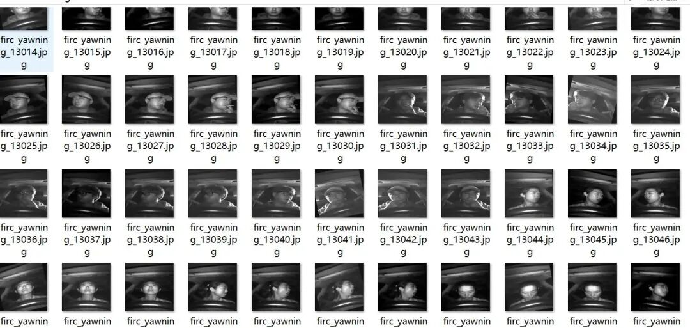
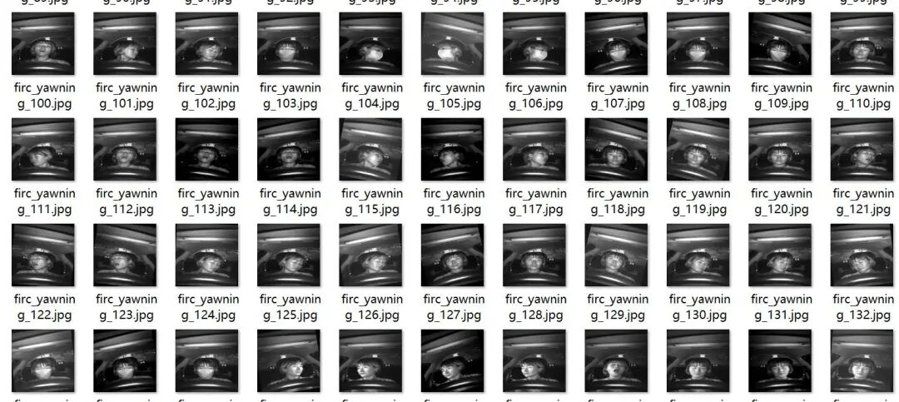
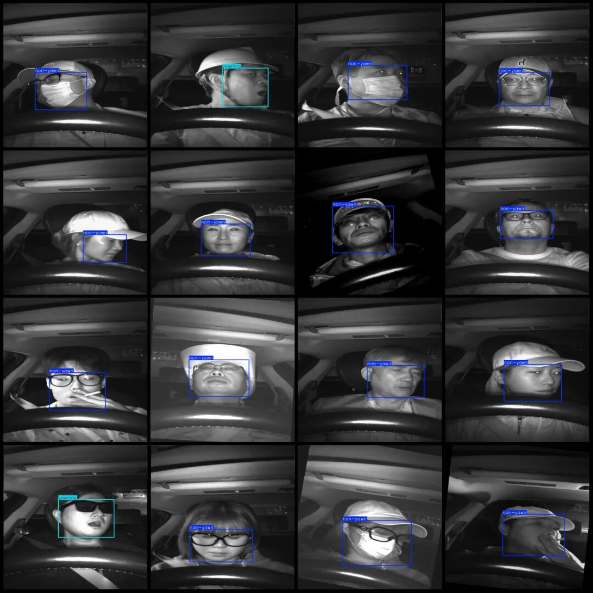

# Hap-Detection Dataset: VOC+YOLO format with 16300 images in 2 categories

The images were taken from the driver's seat during nighttime, please view the images.

The images were taken from the driver's seat during nighttime, please view the images.

Dataset format: Pascal VOC format + YOLO format (txt file without split path, only containing jpg images and corresponding VOC format xml files and yolo format txt files)

Number of images (number of jpg files): 16300

Number of annotations (number of xml files): 16300

Number of annotations (number of txt files): 16300

Labeling category count: 2

Image resolution: 640x640

Label category names (note that the order of yolo format categories does not correspond to this, but is based on the labels folder's classes.txt): ["non-yawn", "yawning"]

Number of boxes labeled in each category:

Non-yawn frame count = 14123

yawning Frames = 2177

Total frame count: 16300

Using labelImg:

Annotation rules: Draw a rectangle around the category.

Important Notice: No

Special : This dataset does not guarantee the accuracy or precision of the trained models or weight files. The dataset is provided with accurate and reasonable annotations only.

Image Preview:

Annotation example:

## Payment

Here is a pay link on Stripe ( https://buy.stripe.com/3cs8yP7sY87d0vu9AB ). Please contact me lonlonago@foxmail.com after funding $89, and I will send you a complete data files , thank you!

